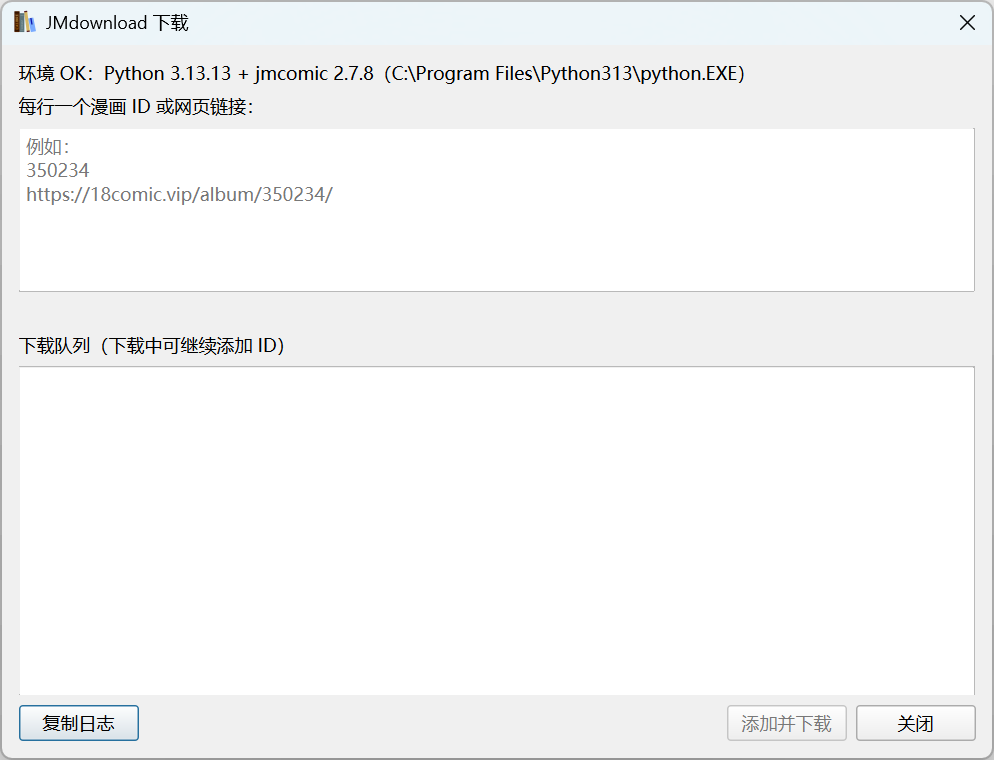
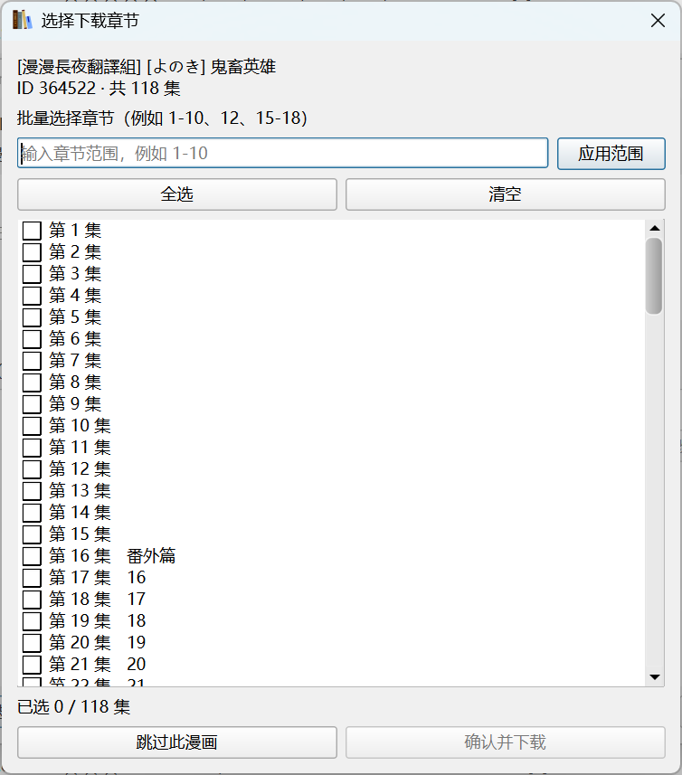

<p align="center">
  
</p>

<h1 align="center">jmdownload-calibre</h1>

Calibre GUI 插件：输入漫画 ID 或网页链接，选择章节，下载并打包为 CBZ，带元数据导入当前书库。

## 插件功能

- **下载导入**：输入 JM 漫画 ID 或网页链接，自动下载、打包 CBZ 并导入 Calibre。
- **自动元数据**：写入标题、作者、标签、简介、日期和封面，无需手动编辑。
- **章节选择**：默认不超过 3 集自动下载全部，超过时弹窗选择；支持勾选和输入章节范围，门槛可配置。
- **下载队列**：下载中可继续追加漫画，每条任务支持修改等待中的章节或直接移除。
- **封面预览**：章节读取与封面加载分开进行，纵向封面加载成功后补到队列。
- **进度与诊断**：支持重复检测、下载进度、会话日志复制和环境检测。
- **项目搭配**：结合 [calibre-metamanga](https://github.com/ZongPou/calibre-metamanga)，使用 AI 识别并更正元数据。
- **完整流程**：下载 → 打包 → 导入 → AI 校正，减少手动管理。

### 安装插件

- 从本项目的 [Releases 页面](https://github.com/ZongPou/jmdownload-calibre/releases) 获取已发布的插件 zip，或使用本地构建包 `dist/jmdownload-calibre-v0.3.4.zip`，不要解压。
- 打开 Calibre：**首选项 → 插件 → 从文件加载插件**，选择下载的 zip。
- 确认安装并重启 Calibre。
- 在系统 Python 中安装下载引擎：

   ```bash
   python -m pip install jmcomic
   ```

### 使用插件

- 点击 Calibre 工具栏中的 **JMdownload**。
- 输入一个或多个漫画 ID/网页链接，每行一个。
- 点击 **添加并下载**。插件后台读取章节，成功后立即按配置门槛处理（默认不超过 3 集自动下载全部，否则弹窗选择）。
- 在章节弹窗中逐集勾选，或输入 `1-10、12、15-18` 等范围后点击 **应用范围**，再点击 **确认并下载**；也可跳过该漫画。
- 下载过程中输入框保持可用，可以继续追加 ID。
- 每条队列任务右侧可修改或删除。
- 完成后将带有标题、作者、标签、简介、日期和封面的 CBZ 直接导入当前书库。
- 在工具栏 **JMdownload 右侧下拉菜单 → 配置…** 修改自动下载集数门槛；设为 `0` 时始终选择章节。

插件还支持：

- `jmcomic:<id>` 识别原漫画，选集使用附加的 `jmchapters:` 标识符区分；同一选集已入库时跳过，已有全本时跳过选集
- `url:` 标识符，支持从书籍元数据回到漫画页面
- 代理、临时目录、解释器和网站域名配置
- 会话日志复制与环境诊断

## 界面截图

下载窗口：支持输入多个漫画 ID 或链接，下载中可继续添加任务。



章节选择：支持逐集勾选、全选、清空，以及输入 `1-10` 等范围批量选择。




## 环境要求

- Calibre：插件声明最低版本为 7.0.0，本机使用 9.15.0 验证。
- 独立的系统 Python 与 `jmcomic` 下载引擎：本机使用 Python 3.13.13、jmcomic 2.7.8；可在插件配置中指定解释器路径。
- 能访问漫画接口及图片服务器的网络；需要时在插件配置中填写代理。

插件使用系统 Python 子进程下载，不向 Calibre 内嵌 Python 安装下载依赖。GUI 插件输出 CBZ，不需要 `calibredb` 在 PATH 中，也不需要 PDF 转换依赖 `img2pdf`。

## 许可证

本项目基于 [MIT License](LICENSE) 发布。

Copyright (c) 2026 yifenliwu

## 致谢

- [jmcomic-calibre](https://github.com/yifenliwu/jmcomic-calibre) —— 本项目的上游。本插件由其 `jmcal` CLI 改造而来，图片自然排序打包与 OPF 元数据生成逻辑源自上游实现。
- [jmcomic](https://pypi.org/project/jmcomic/) —— 提供漫画下载引擎。
- [Calibre](https://calibre-ebook.com/) —— 本插件基于其插件接口开发。

上述第三方软件遵循其各自的原许可证，本项目不包含、不重新分发其代码。
