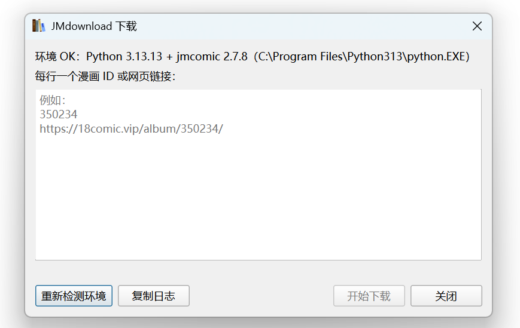

<p align="center">
  
</p>

<h1 align="center">jmdownload-calibre</h1>

## 插件功能

- **下载导入**：输入 JM 漫画 ID 或网页链接，自动下载、打包 CBZ 并导入 Calibre。
- **自动元数据**：写入标题、作者、标签、简介、日期和封面，无需手动编辑。
- **批量管理**：支持多条输入、重复检测、进度显示、取消下载和日志诊断。
- **项目搭配**：结合 [calibre-metamanga](https://github.com/ZongPou/calibre-metamanga)，使用 AI 识别并更正元数据。
- **完整流程**：下载 → 打包 → 导入 → AI 校正，减少手动管理。

### 安装插件

- 前往本项目的 [Releases 页面](https://github.com/ZongPou/jmdownload-calibre/releases)，下载最新版本的插件 zip 包，不要解压。
- 打开 Calibre：**首选项 → 插件 → 从文件加载插件**，选择下载的 zip。
- 确认安装并重启 Calibre。
- 在系统 Python 中安装下载引擎：

   ```bash
   python -m pip install jmcomic
   ```

### 使用插件

- 点击 Calibre 工具栏中的 **JMdownload**。
- 输入一个或多个漫画 ID/网页链接，每行一个；空行和 `#` 注释行会被忽略。
- 点击下载。插件会显示每本漫画的进度，完成后将带有标题、作者、标签、简介、日期和封面的 CBZ 直接导入当前书库。

插件还支持：

- `jmcomic:<id>` 精确判重，已入库项目自动跳过
- `url:` 标识符，支持从书籍元数据回到漫画页面
- 代理、临时目录、解释器和网站域名配置
- 会话日志复制与环境诊断

## 界面截图



JMdownload 窗口支持输入漫画 ID 或网页链接，并在下载前检测 Python 与 jmcomic 运行环境。

## 环境要求

- Python 3.9+
- Calibre（`calibredb` 在 PATH 里）
- `img2pdf`（转 PDF 时需要，装 `[pdf]` extra 即可）

`--format cbz` 只需要标准库，不用额外依赖。

## 许可证

本项目基于 [MIT License](LICENSE) 发布。

Copyright (c) 2026 yifenliwu

## 致谢

- [jmcomic-calibre](https://github.com/yifenliwu/jmcomic-calibre) —— 本项目的上游。本插件由其 `jmcal` CLI 改造而来，图片自然排序打包与 OPF 元数据生成逻辑源自上游实现。
- [jmcomic](https://pypi.org/project/jmcomic/) —— 提供漫画下载引擎。
- [Calibre](https://calibre-ebook.com/) —— 本插件基于其插件接口开发。

上述第三方软件遵循其各自的原许可证，本项目不包含、不重新分发其代码。
